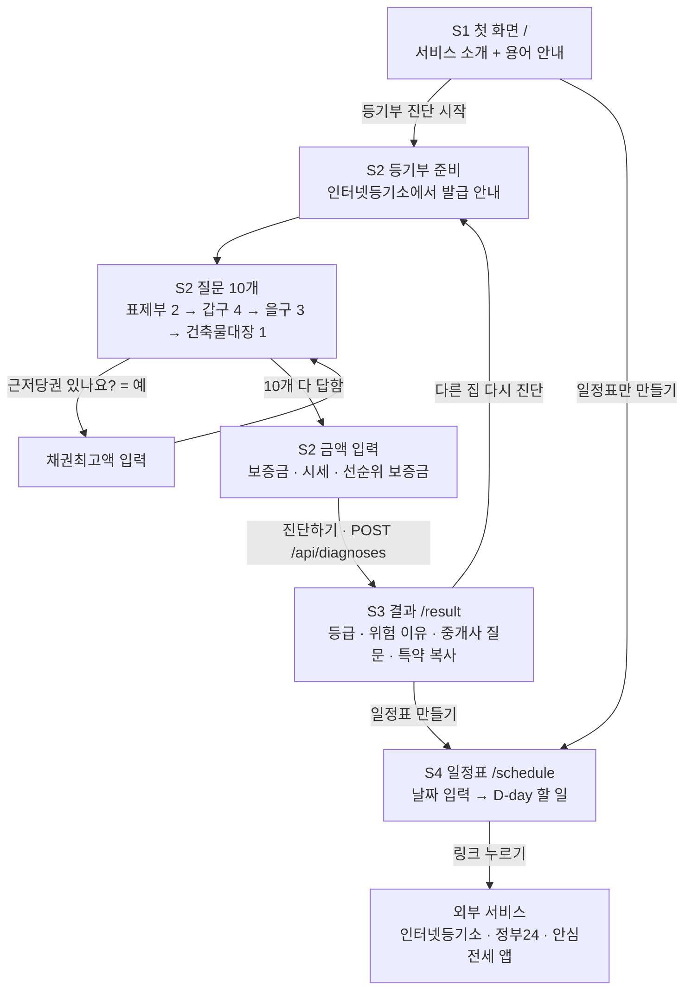
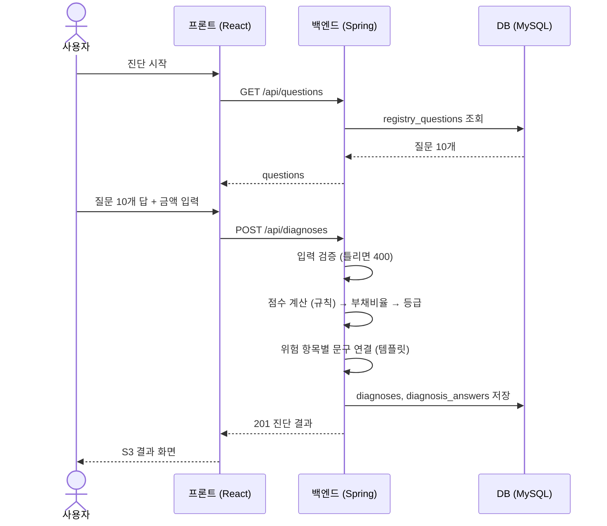
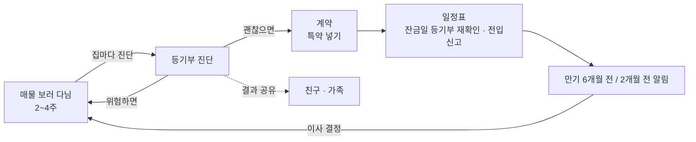

# 서비스 흐름

> 상태: **초안 (오늘 17시 범위 기준)**. 화면 경로는 FE가 라우팅할 때 이 표를 그대로 쓴다.
> 그림은 Mermaid라서 GitHub에서 열면 그려져.

## 1. 한 줄 흐름 (가이드의 INPUT → PROCESS → OUTPUT)

| 단계 | 기능 1 등기부 진단 | 기능 2 계약 일정표 |
|---|---|---|
| **INPUT** | 등기부를 옆에 두고 질문 10개에 답 + 보증금·시세·채권최고액 입력 | 계약일·잔금일·입주일 입력 |
| **PROCESS** | 규칙 기반 점수 계산 → 부채비율 → 등급 → 위험 항목별 안내 문구 연결 | 기준일 + 며칠 차이로 할 일 14개 날짜 계산 |
| **OUTPUT** | 🟢🟡🔴 등급, 위험 이유, 중개사에게 물어볼 질문, **특약 문구 복사** | 지난 일 / 오늘 할 일 / 다가오는 일, 외부 서비스 링크 |

## 2. 사용자 화면 흐름

| 화면 | 경로 | 담당 | 부르는 API | 다음 화면 |
|---|---|---|---|---|
| S1 첫 화면 | `/` | FE | 없음 | S2, S4 |
| S2 진단 (준비 → 질문 → 금액) | `/diagnosis` | FE | `GET /api/questions`, `POST /api/diagnoses` | S3 |
| S3 결과 | `/result` | FE | 없음 (S2가 받은 응답을 넘겨받음) | S2, S4 |
| S4 일정표 | `/schedule` | FE | `GET /api/schedule` | 외부 링크 |

- S2는 한 페이지 안에서 단계만 바뀐다: **준비 → 질문 1~10 → 금액 입력**. 상단에 진행 표시 (예: `질문 3/10`)
- 질문 중에는 **이전 버튼**으로 답을 고칠 수 있다
- S3는 진단 응답을 화면 상태로 받아서 그린다. 새로고침하면 데이터가 없으니 S1으로 보낸다 (공유 링크 `GET /api/diagnoses/{id}`는 내일)

## 3. 화면별 내용

### S1 첫 화면
- 한 줄 소개: "도장 찍기 전에, 등기부부터 같이 읽어요" (팀 이름 정해지면 수정)
- 용어 카드 6개: 등기부등본, 표제부, 갑구, 을구, 빨간 줄, 건축물대장 (docs/01 0절)
- 버튼 2개: **[등기부 진단 시작]** **[일정표만 만들기]**
- 작은 글씨: "이미 안심전세 앱을 쓰고 있다면 같이 쓰면 더 좋아요"

### S2 진단
1. **준비**: "인터넷등기소에서 등기부등본을 발급해 옆에 두세요" + 링크, 건축물대장은 정부24 링크
2. **질문 10개**: 질문 문장, 쉬운 설명(`help`), 버튼 `예` / `아니오` / `모르겠어요`
   - `B1_MORTGAGE`에 `예` → 채권최고액 입력칸 (여러 개면 합계)
   - `모르겠어요`를 누르면 "중개사에게 확인하세요" 한 줄 표시
3. **금액 입력**: 보증금, 매매 시세, 선순위 보증금(선택, "다가구주택이면 중개사에게 물어보세요") — 전부 만원 단위
4. **진단하기** → `POST /api/diagnoses`

### S3 결과
| 순서 | 블록 | 데이터 |
|---|---|---|
| 1 | 등급 카드: 색, 점수, 등급 문구 | `grade`, `score`, `gradeMessage` |
| 2 | 한 줄 설명 | `aiExplanation` (오늘은 템플릿) |
| 3 | 위험 항목 카드 (점수 큰 순서) | `factors[]`의 `title`, `explanation` |
| 4 | 중개사에게 물어볼 질문 목록 | `factors[].askAgent` + `commonAdvice.askAgent` |
| 5 | 특약 문구 + **복사 버튼** | `factors[].specialClause` + `commonAdvice.specialClause`. `null`이면 "계약 보류를 권해요" |
| 6 | 경고 | `warnings[]` |
| 7 | 면책 문구 (항상) | `disclaimer` |
| 8 | 버튼: **[일정표 만들기]** **[다른 집 다시 진단]** | |

### S4 일정표
- 입력: 계약일, 잔금일, 입주일(비우면 잔금일과 같음)
- 결과: **지난 일 / 오늘 할 일 / 다가오는 일** 세 묶음, 각 항목에 D-day, 이유, 링크
- `important: true`(잔금 전 등기부 재확인, 당일 전입신고)는 빨간 강조

## 4. 시스템 흐름 (진단 한 번)

- AI는 "위험 항목별 문구 연결" 다음에 끼어드는 자리야 (내일). 실패하면 이 흐름 그대로 템플릿으로 끝난다
- 일정표는 더 단순해: `GET /api/schedule` → BE가 `checklist_items`로 날짜 계산 → 저장 없이 응답

## 5. 에러 흐름

| 상황 | 화면에서 |
|---|---|
| 400 `INVALID_INPUT` | 해당 입력칸 아래에 `message` 빨간 글씨, 그 칸으로 이동 |
| 500 또는 서버 연결 안 됨 | "잠시 후 다시 시도해 주세요" + 다시 시도 버튼. 입력한 답은 지우지 않는다 |
| S3 새로고침 (데이터 없음) | S1으로 이동 |

## 6. 서비스 루프 (Q&A 대비: "전세는 2년에 한 번인데?")

- **반복 1**: 집 구하는 2~4주 동안 매물마다 진단 (보통 3~5곳)
- **반복 2**: 계약하고 끝이 아니라 잔금일·입주일·만기까지 일정표를 다시 연다
- **확산**: 결과를 친구·가족에게 공유 (공유 링크는 내일 범위)
