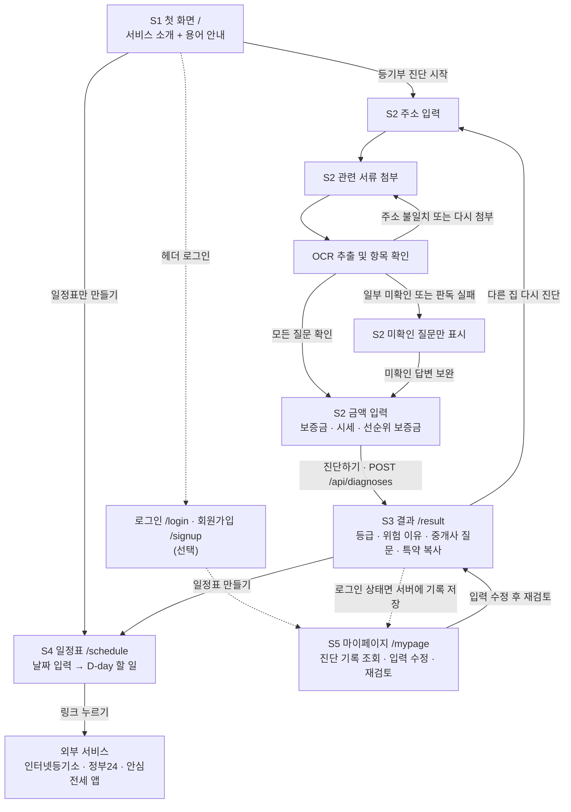
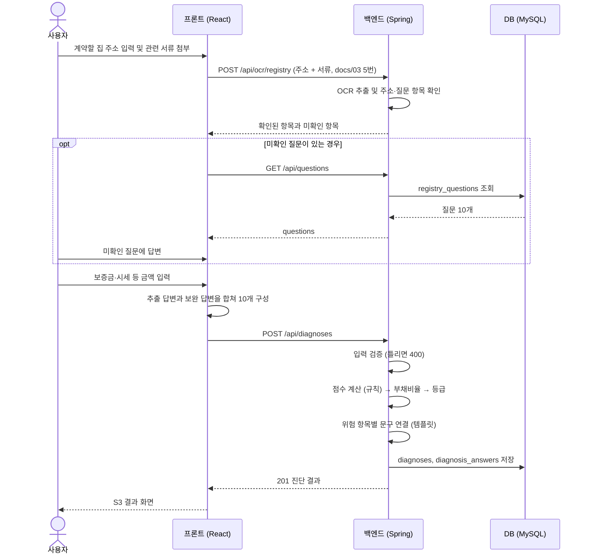
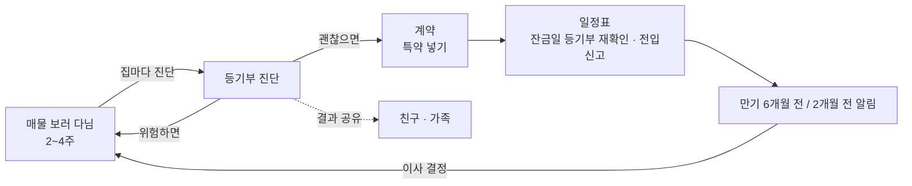

# 서비스 흐름

> 상태: **OCR 흐름 개정 초안**. 화면 경로는 FE가 라우팅할 때 이 표를 그대로 쓴다.
> 그림은 Mermaid라서 GitHub에서 열면 그려져.

## 1. 한 줄 흐름 (가이드의 INPUT → PROCESS → OUTPUT)

| 단계 | 기능 1 등기부 진단 | 기능 2 계약 일정표 |
|---|---|---|
| **INPUT** | 계약할 집 주소와 관련 서류 첨부, 미확인 항목 보완, 보증금·시세 등 입력 | 계약일·잔금일·입주일 입력 |
| **PROCESS** | OCR 추출 → 질문별 확인 → 규칙 기반 점수·부채비율·등급 계산 | 기준일 + 며칠 차이로 할 일 14개 날짜 계산 |
| **OUTPUT** | 🟢🟡🔴 등급, 위험 이유, 중개사에게 물어볼 질문, **특약 문구 복사** | 지난 일 / 오늘 할 일 / 다가오는 일, 외부 서비스 링크 |

## 2. 사용자 화면 흐름

| 화면 | 경로 | 담당 | 부르는 API | 다음 화면 |
|---|---|---|---|---|
| S1 첫 화면 | `/` | FE | 없음 | S2, S4 |
| S2 진단 (주소 → 첨부 → OCR → 보완 질문 → 금액) | `/diagnosis` | FE | `POST /api/ocr/registry`, `GET /api/questions`, `POST /api/diagnoses` | S3 |
| S3 결과 | `/result` | FE | 없음 (S2가 받은 응답을 넘겨받음) | S2, S4 |
| S4 일정표 | `/schedule` | FE | `GET /api/schedule` | 외부 링크 |
| 로그인 · 회원가입 (선택) | `/login`, `/signup` | FE·BE | 인증 API(세부 방식 결정 필요) | 이전 화면 또는 S1 |
| S5 마이페이지 | `/mypage` | FE·BE | 본인 진단 목록·상세·수정/재검토 API | S3, S4 |

- S2는 한 페이지 안에서 단계만 바뀐다: **주소 → 첨부 → OCR → 필요한 질문만 보완 → 금액 입력**. 보완 질문이 있으면 해당 질문 수를 기준으로 진행을 표시한다 (예: `질문 1/3`)
- 질문 중에는 **이전 버튼**으로 답을 고칠 수 있다
- **로그인은 선택이다.** 비로그인도 S1~S4를 전부 쓴다. 로그인 없이 들어갈 수 없는 곳은 S5 마이페이지뿐이다 (들어가면 로그인 화면으로 보낸다)
- 로그인 상태에서만 진단 원본과 결과를 서버 DB에 저장한다. **비로그인 진단은 저장하지 않는다**
- 마이페이지는 최근 5건을 최초 진단일 오름차순으로 표시한다. 재검토하면 전체 결과를 재계산하고 기존 기록을 덮어쓴다
- S3는 진단 응답을 화면 상태로 받아서 그린다. 새로고침하면 데이터가 없으니 S1으로 보낸다 (공유 링크 `GET /api/diagnoses/{id}`는 내일)

## 3. 화면별 내용

### S1 첫 화면 (한 페이지 랜딩, 11/9 팀 피드백 반영)
- 한 줄 소개: "도장 찍기 전에, 서류부터 확인해 드릴게요." / 부제: "등기부등본과 건축물대장을 올려 주세요. 서류로 확인하지 못한 것만 물어볼게요."
- 버튼 2개: **[서류 진단 시작]** **[일정표만 만들기]**
- 등기부 예시: 표제부·갑구·을구를 누르면 그 칸에서 확인하는 질문(docs/01)을 보여준다
- 진행 순서 4단계: 주소 → 서류 올리기 → 확인 못 한 것만 답하기 → 결과 받기
- 결과 미리보기: 안전·주의·위험을 눌러 등급 범위와 문구(docs/01 3절)를 미리 본다
- 용어 카드 7개: 등기부등본, 표제부, 갑구, 을구, 빨간 줄, 건축물대장, 건축물대장부 (docs/01 0절 + 팀장 결정)
- 신뢰 안내: 서류·주소는 저장하지 않음, 점수는 규칙으로만 계산, 면책 문구
- 작은 글씨: "이미 안심전세 앱을 쓰고 있다면 같이 쓰면 더 좋아요"

### S2 진단
1. **주소 입력**. 계약할 집의 주소와 해당하는 동·호수를 입력한다.
2. **서류 첨부**. 등기부등본·건축물대장 등 관련 서류를 첨부한다. 발급 안내 링크를 함께 제공한다.
3. **OCR 추출**. 주소와 서류가 같은 집인지 확인하고, 문서로 판단할 수 있는 답을 채운다. 주소가 다르면 안내 후 주소 수정 또는 서류 재첨부로 돌아간다.
4. **보완 질문**. 확인된 답을 유지하고 미확인 질문만 기존 순서로 보여준다. 질문이 모두 확인되면 이 단계를 건너뛴다. 판독 실패 시 다시 첨부하거나 확인하지 못한 질문에 직접 답할 수 있다. 사용자가 `모르겠어요`를 선택한 경우 중개사에게 확인하도록 안내한다.
5. **금액 입력**. 보증금·매매 시세(필수), 선순위 보증금(선택)을 만원 단위로 입력한다. 근저당이 확인되면 추출된 채권최고액 합계를 확인할 수 있게 하고, 금액을 읽지 못했다면 금액만 입력받는다.
6. **진단하기**. 추출된 답과 보완 답을 합쳐 질문 코드 10개에 대한 답을 구성한 뒤 기존 `POST /api/diagnoses`로 보낸다. OCR 업로드 계약은 별도로 정의한다.

### S3 결과
| 순서 | 블록 | 데이터 |
|---|---|---|
| 1 | 등급 카드: 색, 점수, 등급 문구 | `grade`, `score`, `gradeMessage` |
| 2 | 한 줄 설명 | `aiExplanation` (오늘은 템플릿) |
| 3 | 위험 항목 카드 (점수 큰 순서) | `factors[]`의 `title`, `explanation` |
| 4 | 중개사에게 물어볼 질문 목록 | `factors[].askAgent` + `commonAdvice.askAgent` |
| 5 | 특약 문구 + **복사 버튼** | `factors[].specialClause` + `commonAdvice.specialClause`. `null`이면 "계약 보류를 권해요" |
| 6 | 경고 | `warnings[]` |
| 7 | 면책 문구 (항상) | `disclaimer` |
| 8 | 버튼: **[일정표 만들기]** **[다른 집 다시 진단]** | |

### S4 일정표
- 입력: 계약일, 잔금일, 입주일(비우면 잔금일과 같음)
- 결과: **지난 일 / 오늘 할 일 / 다가오는 일** 세 묶음, 각 항목에 D-day, 이유, 링크
- `important: true`(잔금 전 등기부 재확인, 당일 전입신고)는 빨간 강조

### S5 마이페이지 (로그인한 사람만)
- 내 이름·이메일, 최근 진단 기록 5건. 최초 진단일 오름차순
- 기록 상세에서 진단 당시의 금액과 질문 10개의 답변을 불러온다
- 입력을 수정하고 **[다시 검토하기]**를 누르면 전체 결과를 다시 계산해 기존 기록을 덮어쓴다
- 다른 회원의 기록은 조회하거나 수정할 수 없다
- 버튼: **[등기부 진단 시작]** **[계약 일정표]**

## 4. 시스템 흐름 (진단 한 번)

- AI는 "위험 항목별 문구 연결" 다음에 끼어드는 자리야 (내일). 실패하면 이 흐름 그대로 템플릿으로 끝난다
- 일정표는 더 단순해: `GET /api/schedule` → BE가 `checklist_items`로 날짜 계산 → 저장 없이 응답

## 5. 에러 흐름

| 상황 | 화면에서 |
|---|---|
| OCR 판독 실패 또는 정보 부족 | 확인된 항목을 유지하고 재첨부 또는 미확인 항목 수동 답변을 안내한다 |
| 주소 불일치 | 해당 서류로 자동 입력을 진행하지 않고 주소 수정 또는 맞는 서류 재첨부를 안내한다 |
| 400 `INVALID_INPUT` | 해당 입력칸 아래에 `message` 빨간 글씨, 그 칸으로 이동 |
| 500 또는 서버 연결 안 됨 | "잠시 후 다시 시도해 주세요" + 다시 시도 버튼. 입력한 답은 지우지 않는다 |
| S3 새로고침 (데이터 없음) | S1으로 이동 |

## 6. 서비스 루프 (Q&A 대비: "전세는 2년에 한 번인데?")

- **반복 1**: 집 구하는 2~4주 동안 매물마다 진단 (보통 3~5곳)
- **반복 2**: 계약하고 끝이 아니라 잔금일·입주일·만기까지 일정표를 다시 연다
- **확산**: 결과를 친구·가족에게 공유 (공유 링크는 내일 범위)
